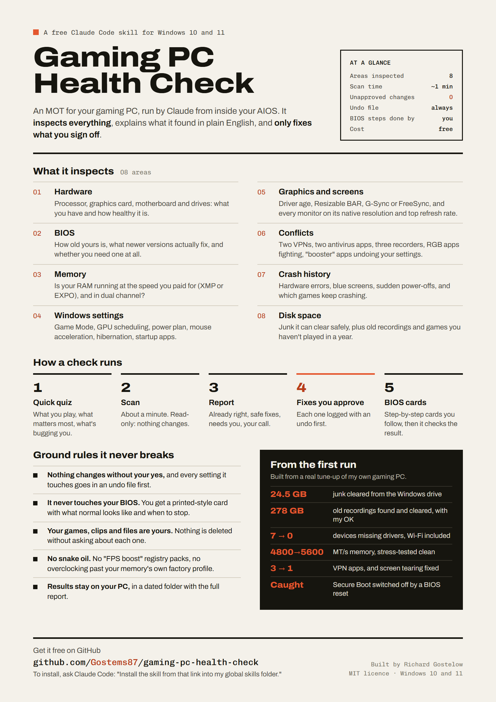

# Gaming PC Health Check

A Claude Code skill that gives your Windows gaming PC a full MOT. Run it from your AIOS (or any Claude Code session) and Claude inspects the hardware, the BIOS, the memory, Windows and graphics settings, conflicting software, crash history and disk space, then explains what it found in plain English and fixes only what you sign off.



## What it checks

- **Hardware:** processor, graphics card, motherboard, drives and their health.
- **BIOS:** how old yours is, what the newer versions actually fix, and whether you need one at all.
- **Memory:** whether your RAM is running at the speed you paid for (XMP or EXPO) and in dual channel.
- **Windows settings:** Game Mode, GPU scheduling, power plan, mouse acceleration, hibernation, startup apps.
- **Graphics and screens:** driver age, Resizable BAR, G-Sync or FreeSync, and whether each monitor is on its native resolution and top refresh rate.
- **Conflicts:** two VPNs, two antivirus apps, three recorders, RGB apps fighting each other, "booster" apps undoing your settings.
- **Crash history:** hardware errors, blue screens, sudden power-offs, and which games keep crashing.
- **Disk space:** junk it can clear safely, plus old recordings and games you haven't played in a year (your call, item by item).

It starts with a quick quiz about what you play and what's bugging you, so the advice fits a Counter-Strike player differently from a Flight Simulator pilot.

## How a check runs

1. **Quiz:** four quick questions.
2. **Scan:** about a minute, read-only. Nothing on your PC changes.
3. **Report:** plain English, sorted into four piles: already right, safe fixes, needs you, your call.
4. **Safe fixes:** only the ones you approve. Every change is written to an undo file first, so one command puts it all back.
5. **BIOS cards:** for anything in the BIOS (an update, turning on your RAM's profile, Secure Boot), you get a step-by-step card to follow yourself. Claude then checks the result from Windows.

## Ground rules it follows

- Changes nothing without your yes, and keeps an undo file for every setting.
- Never touches your BIOS itself.
- Never deletes your games, clips or files without asking about each one.
- No overclocking beyond your memory's own factory profile, and no snake-oil "FPS boost" tweaks.
- The scan results stay in a folder on your PC. Claude reads them to write your report, the same as any file you work on with Claude Code; nothing is uploaded anywhere else.

## What you need

- A Windows 10 or 11 PC (desktop or laptop).
- Claude Code, inside your AIOS or any project.
- Admin rights on the PC (Windows will ask you to click Yes once or twice).
- About 20 to 30 minutes for the full check and fixes. BIOS jobs are separate and take as long as they take.

## Install

**Easiest:** open Claude Code and say:

> Install the Claude Code skill from https://github.com/Gostems87/gaming-pc-health-check into my global skills folder.

**Or by hand:**

1. On this page click the green **Code** button, then **Download ZIP**, and unzip it.
2. Inside you'll find a folder called `gaming-pc-health-check` with a `SKILL.md` file in it. Copy that folder (the inner one) into `C:\Users\<your-username>\.claude\skills\`. Create the `skills` folder if it isn't there.
3. Restart Claude Code.

**Or with git**, in PowerShell:

```powershell
$src = "$env:TEMP\gaming-pc-health-check"
if (Test-Path $src) { Remove-Item $src -Recurse -Force }
git clone https://github.com/Gostems87/gaming-pc-health-check $src
$dest = "$env:USERPROFILE\.claude\skills\gaming-pc-health-check"
if (Test-Path $dest) { cmd /c rmdir /s /q "$dest" }
New-Item -ItemType Directory -Force "$env:USERPROFILE\.claude\skills" | Out-Null
Copy-Item "$src\gaming-pc-health-check" $dest -Recurse
```

When it's done, this file should exist: `C:\Users\<your-username>\.claude\skills\gaming-pc-health-check\SKILL.md`.

## Use it

Just ask, in plain English:

> Give my gaming PC a health check.

> Why does my PC stutter in Warzone?

> Is my RAM running at full speed?

Claude asks its quiz, runs the scan, and hands you a report in a dated folder (`outputs\pc-health-check-<date>` in an AIOS, otherwise in your Documents).

## Where it came from

It was built from a real tune-up of my own gaming PC. That first run cleared 24.5 GB of junk, found 278 GB of old recordings, fixed seven devices that had no drivers (including the Wi-Fi and Bluetooth), took the memory from 4,800 to 5,600 MT/s and stress-tested it clean, fixed the screen tearing, and cut three VPN apps down to one. Turning it into this skill, the second run caught something the first had missed: a BIOS reset had quietly switched Secure Boot off, which stops several anti-cheat games from launching.

## What's in this repository

- `gaming-pc-health-check/` is the skill itself (the folder you copy). `SKILL.md` is the method Claude follows; `scripts/` holds three PowerShell scripts (the read-only scan, the fix-applier with its undo file, and an after-care check); `references/` holds the detail Claude opens when it needs it.
- `docs/` holds the one-page explainer above, as a PNG, a PDF and its HTML source.

## A sensible warning

The skill is built to be cautious: read-only first, a preview before every change, an undo file, and no hands on your BIOS. Even so, BIOS updates and memory profiles always carry a small risk, and you follow those steps yourself. Back up anything you can't afford to lose before you start. You use it at your own risk, as the licence says.

## Licence

MIT: see [LICENSE](LICENSE). Use it, change it, share it.
